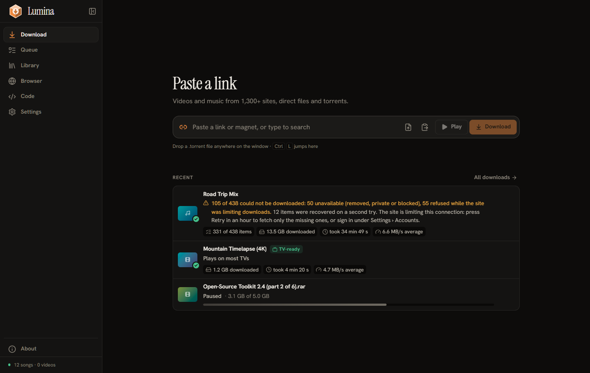
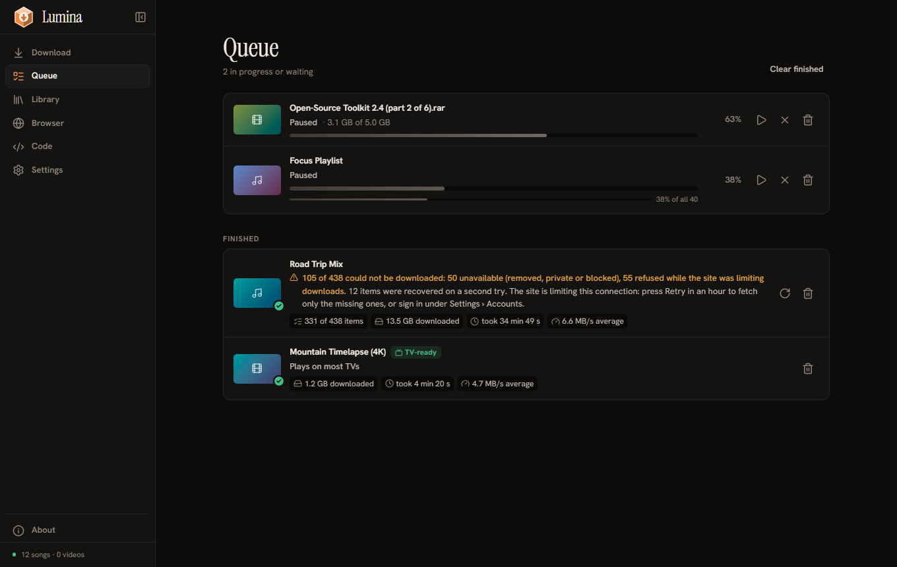
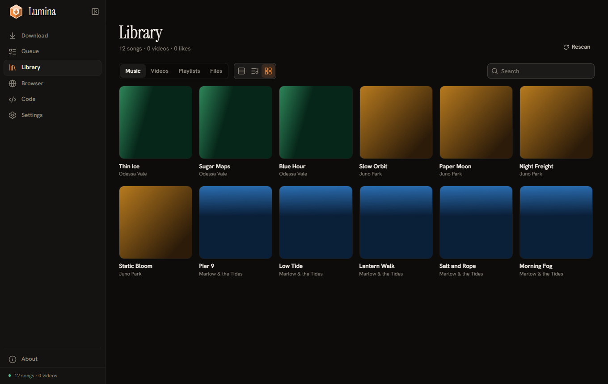
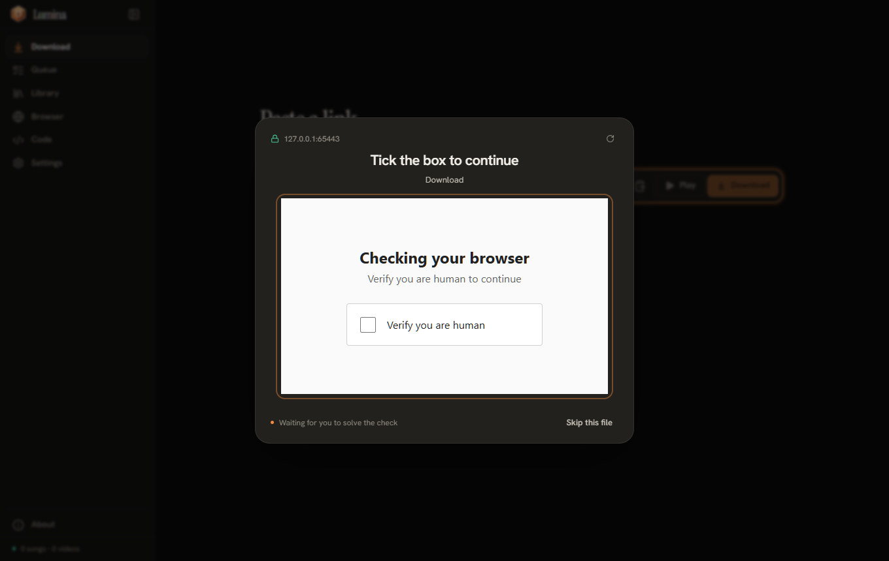
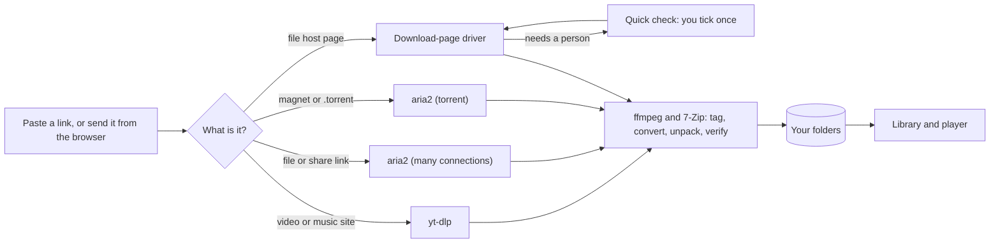
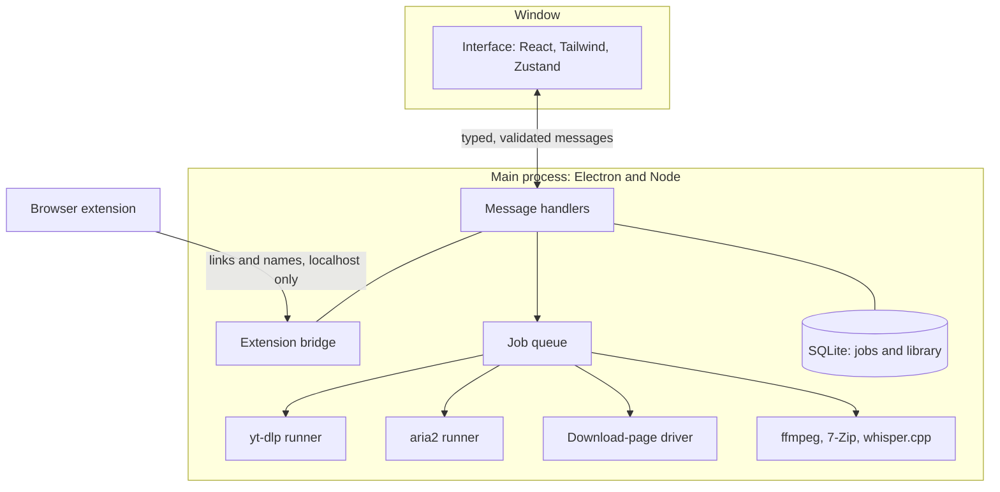

# Lumina

A download assistant and media player for your own computer. Paste a link, or send one from your browser, and Lumina finds the file, downloads it, and puts it where you can play it.



## What it does

- **Downloads from most places.** Videos and music from over a thousand sites (through [yt-dlp](https://github.com/yt-dlp/yt-dlp)), plain files, share links, torrents and magnet links.
- **Handles download pages.** Many file hosts put a page with buttons and countdowns in front of the file. Lumina opens it, presses the right buttons, and catches the file. If the page asks you to prove you are a person, a small window shows the check and you tick it once. Lumina does not solve checks for you.
- **Keeps going when part of a job fails.** A long playlist where some items are refused is tried again after a rest, more gently, and what is left is explained in plain words.
- **Works with your browser.** An extension sends links from a page to Lumina, with the file names, and picks the best host when the same files are offered in several places.
- **Plays what you have.** A library for music and video from your own folders, with playlists, lyrics and a player.
- **Stays on your computer.** No account is needed, and your downloads and library stay on your machine. The extension only talks to Lumina on `127.0.0.1`.

## Screenshots

| Queue | Library |
| :---: | :---: |
|  |  |

| When a site asks for a check |
| :---: |
|  |

The screens above use made-up sample data.

## How it works

From a link to a file:



Inside the app:



The rules that decide things (what a link is, which items to retry, how a host may be used) live in `src/core` as plain functions with tests, so they can be checked without opening the app.

## Download

Get the latest version from the [Releases page](https://github.com/nikhlgoel/lumina/releases/latest), or see the [website](https://nikhlgoel.github.io/lumina/).

| File | What it is |
| :--- | :--- |
| `Lumina-<version>-Standard-Setup.exe` | Windows. The downloader, the player and the built-in browser. Start here. |
| `Lumina-<version>-Full-Setup.exe` | Windows. Everything in Standard, plus a code editor, terminal, source control and MCP client. |
| `lumina-chromium.zip`, `lumina-firefox.zip` | The browser extension. |
| `lumina-tv-<version>.apk` | The Android app. It has its own version number. |

The Windows installers are not code-signed, so Windows SmartScreen may warn once: choose **More info**, then **Run anyway**. Linux and macOS builds can be made from source but are not part of the current release.

### Adding the browser extension

- **Chrome, Edge, Brave:** unzip `lumina-chromium.zip`, open `chrome://extensions`, turn on **Developer mode**, choose **Load unpacked**, and pick the folder. To update, replace the files and press the reload arrow on the extension.
- **Firefox:** open `about:debugging`, choose **This Firefox**, then **Load Temporary Add-on**, and pick `manifest.json` from the unzipped folder. Firefox forgets temporary add-ons when it closes.

Then open Lumina once and approve the pairing when it asks.

## Built with

| Area | What |
| :--- | :--- |
| App shell | Electron, TypeScript |
| Interface | React 19, Tailwind CSS 4, Zustand, Lucide icons |
| Data | SQLite (`node:sqlite`), Zod for every message between the window and the app |
| Download engines | yt-dlp, aria2 |
| Media tools | FFmpeg, 7-Zip, whisper.cpp (optional local subtitles) |
| Code editor (Full build) | Monaco, xterm.js |
| Browser extension | Manifest V3, plain JavaScript |
| Android app | Kotlin and Gradle, in `tv/` |
| Build and checks | Vite, electron-builder (NSIS), Vitest |

The media tools are downloaded and checked by `scripts/fetch-tools.mjs`, each pinned to a version and verified against its published checksum.

## Build it yourself

You need Node.js and [pnpm](https://pnpm.io/).

```bash
pnpm install
pnpm tools:fetch        # downloads the pinned yt-dlp, aria2, FFmpeg, 7-Zip and whisper.cpp
pnpm dev                # run the app in development

pnpm typecheck          # TypeScript
pnpm test               # unit tests
pnpm build              # production build

pnpm package:win:standard   # Windows installer (use package:win:full for the Full build)
```

Besides the unit tests, the app can test itself against stand-in websites without opening a window. `AGENTS.md` explains how, along with the rules for working in this repository.

## What is where

```
src/core/       The decisions: plain functions with tests, no Electron
src/main/       The app: job queue, engines, extension bridge, files
src/preload/    The sandboxed bridge between the window and the app
src/renderer/   The interface
src/shared/     Message types shared by the app and the window
extension/      The browser extension
tv/             The Android app (its own Gradle project)
tests/          Unit tests and end-to-end checks
docs/           Early design notes and the screenshots above
```

## Where it stands

Lumina is a young project made by one person, and the honest picture is this:

- Windows is what is built and published. Each change is checked with over 1,500 automated tests and with self-tests that run the real app against stand-in sites.
- Real file hosts change their pages and their checks without warning. Lumina reads pages by what they say and where things are, learns from your click when it cannot, and tells you plainly when it cannot continue, but a host can still surprise it.
- Some sites limit how much one connection may download. Lumina keeps to a smaller share of hosts it knows do this, and for a long playlist it rests and retries instead of giving up.
- Please use Lumina for things you have the right to download.

`CHANGELOG.md` lists what changed in each release, `HANDOVER.md` says what is built and what is not yet proven, and `DECISIONS.md` explains why things are the way they are.

## Licence and credits

Lumina is [MIT licensed](LICENSE). The Android app in `tv/` is GPL-3.0 (see `tv/LICENSE`). Lumina bundles and builds on other free software, each under its own licence: yt-dlp, aria2, FFmpeg, 7-Zip and whisper.cpp. Thank you to everyone who makes them.
